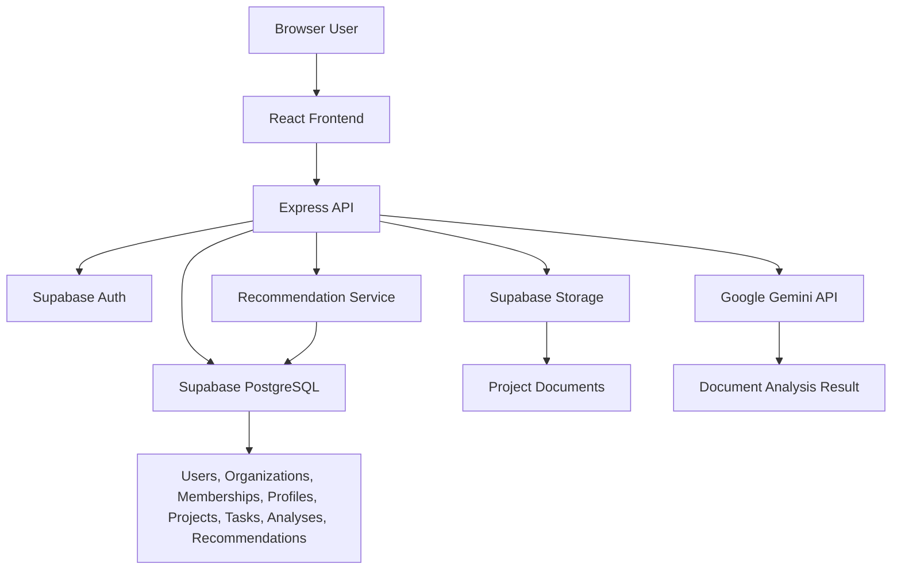
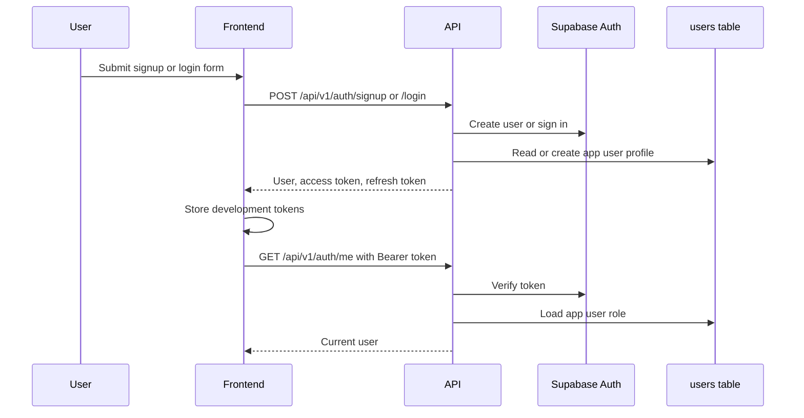
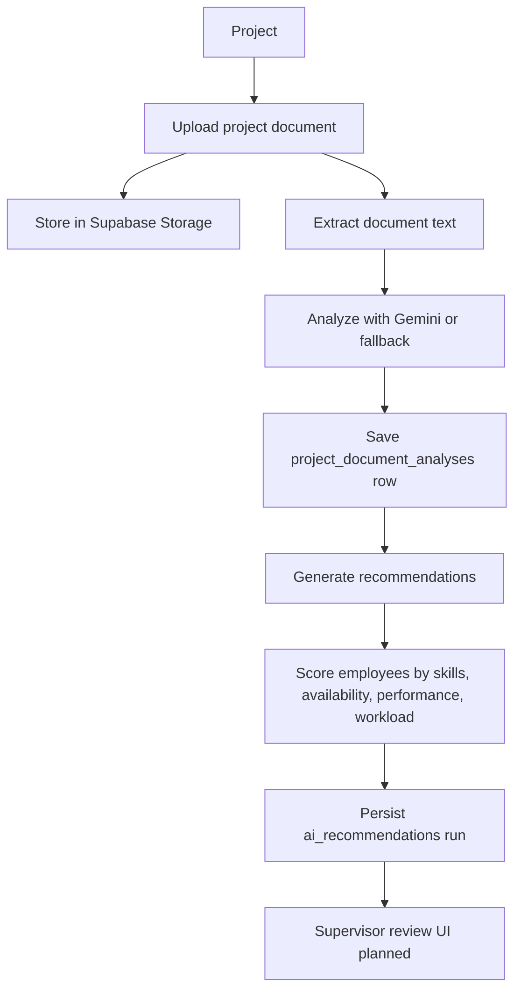
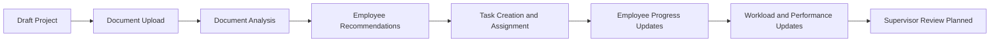
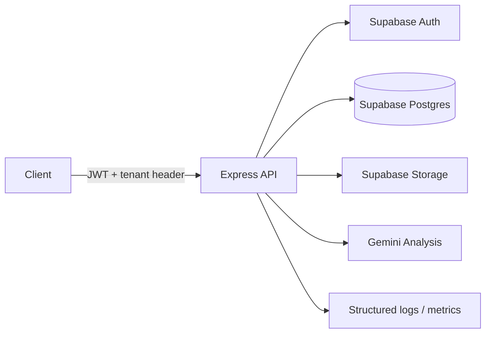

# Supervisor AI

[](https://nodejs.org/)
[](https://expressjs.com/)
[](https://react.dev/)
[](https://www.typescriptlang.org/)
[](https://vite.dev/)
[](https://tailwindcss.com/)
[](https://supabase.com/)

Supervisor AI is a multi-tenant workforce management platform for organization admins, supervisors, and employees. The current implementation provides a TypeScript Express API backed by Supabase and a React frontend with authenticated organization context, organization switching, protected routing, and backend-integrated authentication.

The backend already includes core APIs for authentication, organizations, invitations, employee and supervisor profiles, projects, tasks, dashboards, document uploads, document analysis, and employee recommendations. The frontend includes the application shell, authentication, organization-aware request context, and connected business modules.

## Project Objectives

- Help organization admins and supervisors create projects, manage employees, assign tasks, and track work.
- Analyze uploaded project documents to identify skills, effort, risk, and staffing signals.
- Rank employees for projects using skills, availability, workload, and performance.
- Preserve human review: AI recommendations are advisory and do not auto-assign employees.
- Keep frontend, backend, database, storage, and AI responsibilities clearly separated.

## High-Level Architecture



## Technology Stack

| Layer | Current Technology |
| --- | --- |
| Frontend | React 19, React Router 7, Vite 8 |
| Frontend language | TypeScript 6, strict mode |
| Frontend styling | Tailwind CSS 4 with CSS design tokens |
| HTTP client | Axios |
| Backend | Node.js, Express 5 |
| Backend language | TypeScript 6, strict mode, ES modules |
| Database | Supabase PostgreSQL |
| Authentication | Supabase Auth JWTs |
| Storage | Supabase Storage bucket for project documents |
| Upload handling | Multer in memory storage |
| AI analysis | Google Gemini API with local fallback analysis |

## Repository Structure

```txt
supervisor-ai/
  backend/       Express API, Supabase integration, services, routes, middleware.
  frontend/      React application, auth UI, app shell, design system.
  supabase/      SQL migrations and seed files.
  CODEX.md       Project-level engineering and architecture guide.
```

## Backend Overview

The backend is an Express 5 REST API using a route, controller, service, middleware, and utility structure.

Implemented backend capabilities:

- Public auth plus authenticated organization discovery.
- Organization creation, membership resolution, invitations, and invitation acceptance.
- Platform admin user-role management and skill moderation.
- Organization-scoped employee and supervisor profile APIs.
- Organization-scoped project, task, dashboard, document, and recommendation APIs.
- Workload and performance recalculation after assignment and progress changes.
- TXT extraction plus Gemini-backed or fallback document analysis.
- Repeatable tenant-isolation verification dataset and API verification script.

See [backend/README.md](backend/README.md) for the API reference and backend architecture.

## Frontend Overview

The frontend is a Vite React application with feature-based organization.

Implemented frontend capabilities:

- Locked brand color tokens and Supervisor logo component.
- Login and signup screens connected to the backend auth API.
- Auth provider with session restore, logout, and 401 handling.
- Organization provider with active membership resolution and organization switching.
- Shared Axios client that attaches `X-Organization-Id` to tenant-scoped requests.
- Responsive app shell with role-aware navigation.
- Connected dashboards, projects, tasks, employees, profile, documents, and recommendation screens.

See [frontend/README.md](frontend/README.md) for frontend architecture and setup.

## Authentication Overview

Authentication uses Supabase Auth on the backend. The frontend stores the access and refresh tokens for development, restores the user with `/api/v1/auth/me`, loads the authenticated user’s memberships from `GET /api/v1/organizations`, and only sends `X-Organization-Id` after a verified active organization is selected.

Each person can pick an illustrated profile picture on the Profile page (`PATCH /api/v1/auth/me/avatar`, stored in `users.avatar_variant`, the same in every workspace); until they do, and for everyone else in Phase 1, the app shows initials. In `npm run dev`, `/dev/avatars` shows every avatar at each in-app size.



## AI Recommendation Workflow

The current recommendation workflow is backend implemented and frontend planned.



## Project Lifecycle



## Multi-Tenant Model

Organization-scoped authorization is driven by:

- `organizations`
- `organization_members`
- `organization_invitations`

Membership roles:

- `organization_admin`
- `supervisor`
- `employee`

Membership statuses:

- `active`
- `invited`
- `suspended`

`X-Organization-Id` selects the tenant context for business routes. The backend verifies that the authenticated user has a matching active membership before a tenant-scoped operation is allowed.

Platform administration remains separate from organization administration. The legacy `users.role` field still exists for platform compatibility and must not be treated as tenant authorization.

## Database Overview

Migrations under `supabase/migrations` define core application tables and document/recommendation tables.

| Area | Tables or Storage |
| --- | --- |
| Identity | `users` mapped to Supabase Auth users |
| Tenancy | `organizations`, `organization_members`, `organization_invitations` |
| Profiles | `employees`, `supervisors` |
| Work management | `projects`, `tasks`, `task_progress` |
| Documents | `project_documents`, `project_document_analyses` |
| Recommendations | `ai_recommendations` |
| Storage | private `project-documents` bucket |
| Skills | Services use `skills` and `employee_skills`; the current migrations include an `employee_skills` uniqueness migration but do not fully define both tables in the visible migration set. |

## Local Development Setup

## Git Workflow

The repository uses a simple promotion path:

```text
main
  ↑
develop
  ↑
feature/*
```

- `main` contains stable, release-ready code. Do not develop directly on it.
- `develop` is the active integration branch. Small, low-risk fixes such as copy changes,
  minor styling, documentation, or narrowly scoped bug fixes may be committed directly here.
- `feature/*` branches are for substantial features, new pages, or larger refactors. Open a
  pull request from the feature branch into `develop`.

Start substantial work from the latest `develop` branch:

```bash
git switch develop
git pull origin develop
git switch -c feature/employee-profile
```

After the feature is merged into `develop`, update your local branch and prune its merged branch:

```bash
git switch develop
git pull origin develop
git branch -d feature/employee-profile
git fetch --prune
```

Prerequisites:

- Node.js 20 or newer.
- npm.
- A Supabase project with the required schema and storage bucket.
- A Gemini API key if Gemini analysis should run instead of local fallback analysis.

Install backend dependencies:

```bash
cd backend
npm install
```

Install frontend dependencies:

```bash
cd frontend
npm install
```

## Running the Backend

```bash
cd backend
npm run dev
```

The backend defaults to port `5000` when `PORT` is not set. The current frontend Vite proxy targets `http://localhost:4000`, so align `PORT` or update the frontend proxy/environment configuration for local development.

## Running the Frontend

```bash
cd frontend
npm run dev
```

The frontend uses `VITE_API_BASE_URL` when provided and falls back to `/api/v1`.

## Environment Variables

Only variable names are documented here. Do not commit real values.

| Scope | Variables |
| --- | --- |
| Backend | `PORT`, `SUPABASE_URL`, `SUPABASE_SERVICE_ROLE_KEY`, `GEMINI_API_KEY`, `GEMINI_MODEL` |
| Frontend | `VITE_API_BASE_URL` |

## Tenant Isolation Verification

The repository includes a repeatable backend verification script that seeds a dedicated two-organization dataset and checks tenant-scoped APIs for cross-organization isolation failures.

Recommended verification flow:

```bash
cd backend
npm run build
npm run verify:tenant-isolation

cd ../frontend
npm run build
npm run lint
```

Use a safe non-production Supabase environment only.

Known limitations:

- the backend verification script does not replace manual browser testing of organization switching UX
- PDF and DOCX extraction remain limited
- production hardening still needs follow-up work such as a distributed rate limiter for horizontal scaling and broader observability

## Task execution APIs

The backend now supports employee task execution without adding notifications or UI work. Employees use `GET /api/v1/employees/me/tasks`, `GET /api/v1/employees/me/dashboard`, and `PATCH /api/v1/tasks/:taskId/progress`; supervisors use `GET /api/v1/supervisors/dashboard`. All organization-scoped calls require `X-Organization-Id`.

Progress is append-only. A task becomes `todo` (pending) at 0%, `in_progress` at 1–99%, and `completed` at 100%. Project progress is stored as completed estimated hours divided by total estimated hours, multiplied by 100. Completed tasks are excluded from workload calculations, increasing employee availability automatically.

## Team messaging

Members of an organization can chat under **Messages** in the sidebar (`/messages`). The API lives under `/api/v1/messaging` and is documented in the OpenAPI spec at `/api/docs`.

**Conversations**

- **General**: one per organization, created automatically. Every active member can read and post.
- **Project channels**: one per project, created automatically when the project is created (existing projects were backfilled by the migration).
  - Active organization admins and supervisors see every project channel, with the full history. A deleted project's channel becomes read-only for them.
  - Employees see a project's channel while at least one non-deleted task in that project is assigned to them, in any status. Access is checked on every request, so it ends as soon as their last task there is unassigned or deleted, and the channel disappears for them when the project is deleted. Their earlier messages stay, under their name.
  - Employees see messages only from the date their access to the project began. The date is stored (`messaging_project_access`, kept up to date by triggers on `tasks`), so losing one of several tasks never moves it forward. Losing every task in the project ends access; being assigned again starts a new date.
  - A new assignee also sees earlier messages in the channel that tag a task now assigned to them, labelled "Earlier message about your task". Each is shown whole (text, sender, mentions, reactions, task chip), so it can include what was said about the previous assignee; the messages around it stay hidden. These do not count as unread, and they disappear again if the task moves on.
  - In the channel an employee sees the project title, the names and roles of the people who can open it, and the messages. Project pages, documents, analyses, recommendations and other people's tasks stay admin and supervisor only.
- **Direct messages**: between exactly two active members of the same organization. There is one per pair, whoever starts it.

**Privacy: admins cannot read other people's direct messages.** No one, organization admins and supervisors included, can open a direct message they are not part of through the app or the API; the API answers 404. (Anyone with direct database access, such as the service-role key or the Supabase dashboard, can still read the tables.)

**Messages** are plain text up to 4,000 characters, rendered as text and never as HTML. They support @mentions (only of people who can see the conversation), reactions from a curated emoji set, and editing and deleting your own messages. Deleting removes the text, mentions, reactions and task tag; only a "This message was deleted" placeholder remains.

**Task tags and progress requests**

- "Tag a task" attaches a task you can access (employees: only their own). In a project channel the task must belong to that project. Each viewer sees it according to their own task access: people who cannot open the task, including colleagues in the same project channel and a task's former assignee, see only "Restricted task", with no title, status or progress. The message text itself stays visible to everyone who can read it.
- "Ask about this task" (employees, on the task page and task cards) opens the project's channel with the task tagged and suggests the project's creator and other admins and supervisors to @mention. Nobody is mentioned unless the sender picks them.
- "Ask for update" (admins and supervisors) posts a progress request in your direct message with the task's assignee, mentions them, and logs a `task_progress_requested` activity entry. The assignee gets an "Update progress" button that opens the existing progress form. Chat never changes task data.

**Unread state and polling.** There is no realtime connection; the browser polls:

- The open conversation polls every 4 s, slowing to every 15 s after 2 quiet minutes.
- The conversation list and the sidebar badge poll every 30 s.
- Polling pauses while the tab is hidden.

The two polling endpoints have their own per-user limit (240/min) instead of the shared per-IP API limit. Sending is limited to 30 messages per minute per user. These limits are in memory, per server instance.

**Database.** The tables are added by `supabase/migrations/202610220001_team_messaging.sql`; `supabase/rollbacks/202610220001_team_messaging_down.sql` undoes it. Employee access to project channels and per-channel unread counts come from the two functions in `supabase/migrations/202610230001_messaging_project_members.sql`; `supabase/migrations/202610240001_messaging_project_access_history.sql` (applied after it) adds the stored access dates and the tagged-message lookup. Both have rollbacks in `supabase/rollbacks/`, and `supabase/tests/messaging_project_access_backfill_check.sql` is a read-only check that the access table matches live task assignments. All of these are covered by `supabase/tests/`. To run the service tests against a disposable database with the migrations applied: `cd backend && npm run test:messaging`, or `npm run test:integration` for every database-backed backend test (messaging, invitation delivery, task listing). They refuse to run against a non-local `SUPABASE_URL` unless `INTEGRATION_TESTS_ALLOW_REMOTE=true` (`MESSAGING_TESTS_ALLOW_REMOTE=true` for the messaging suite). `npm test` runs only tests that need no database.

## Production operations



Production configuration, deployment requirements, and troubleshooting are documented in [docs/environment.md](docs/environment.md) and [docs/production-readiness.md](docs/production-readiness.md). Operational endpoints are `/health`, `/ready`, `/metrics`, `/api/docs`, and `/api/openapi.json`.

## Current Implementation Status

| Area | Status |
| --- | --- |
| Backend authentication | Implemented |
| Backend role authorization | Implemented |
| Backend employee and supervisor profiles | Implemented |
| Backend project and task APIs | Implemented |
| Backend document upload | Implemented |
| TXT document extraction | Implemented |
| PDF and DOCX extraction | Planned |
| Gemini document analysis | Implemented with fallback |
| Recommendation scoring and persistence | Implemented |
| Frontend auth screens and app shell | Implemented |
| Frontend organization context and switching | Implemented |
| Frontend data-connected dashboards and work management screens | Implemented |
| Automated tenant isolation verification | Implemented |

## Roadmap

| Status | Milestone |
| --- | --- |
| Done | Backend REST foundation with Supabase Auth and PostgreSQL access. |
| Done | Backend profile, project, task, document, and recommendation services. |
| Done | Frontend foundation, brand system, app shell, and authentication flow. |
| Planned | PDF and DOCX text extraction. |
| Planned | Recommendation review, accept, reject, and override workflow. |
| Planned | Notifications and richer analytics APIs. |
| Done | Baseline production deployment hardening, including environment validation, deployment artifacts, health checks, rate limiting, and request observability. |

## Future Milestones

Near-term work should connect the existing frontend placeholders to the implemented backend APIs, complete PDF/DOCX extraction, and add supervisor review workflows for generated recommendations. Longer-term work should add analytics, notifications, broader observability, and production deployment configuration refinements.

## Contributing

Before changing code, read `CODEX.md` and the relevant `backend/CODEX.md` or `frontend/CODEX.md`.

Expected workflow:

1. Keep backend, frontend, and database responsibilities separate.
2. Keep backend business logic in services.
3. Keep frontend pages as route containers.
4. Route frontend API calls through services.
5. Document only implemented behavior.
6. Run the relevant build and lint commands before opening a change.

## License

No repository-level `LICENSE` file is currently present. The backend package metadata declares `ISC`; confirm the intended project license before publishing.
